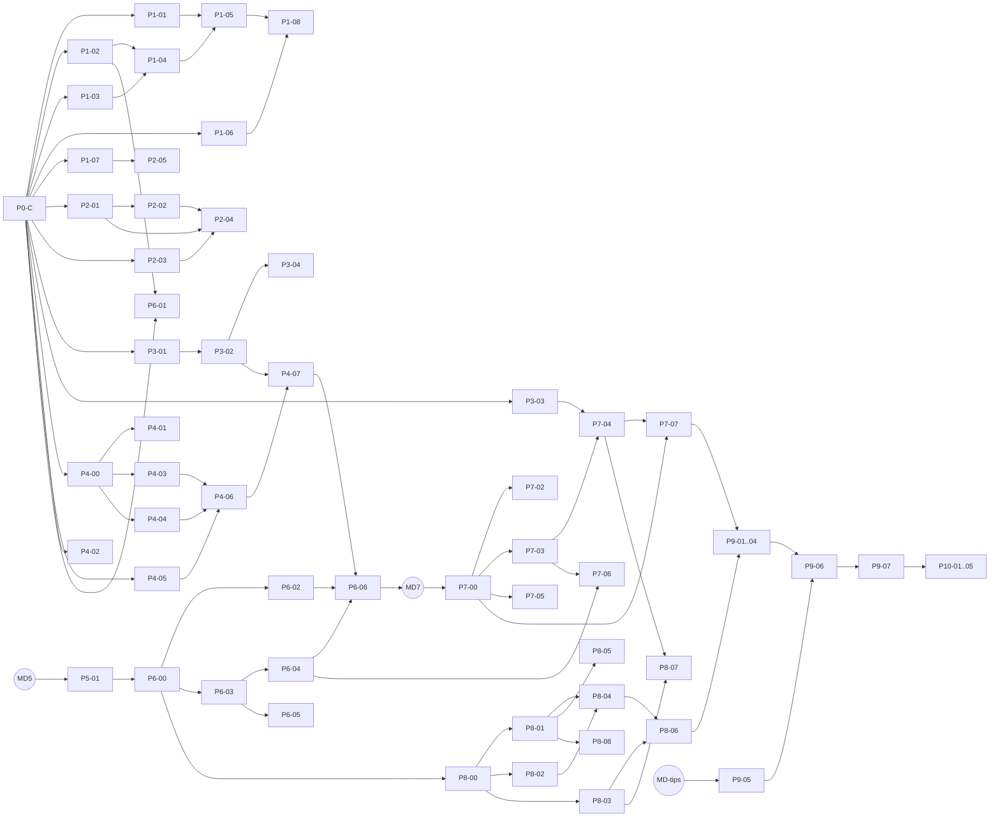

# Roadmap

The backlog of implementation units, one table per phase of `MITO_CONTEXT.md` §26. The
workflow that runs these units is `docs/adr/0006-parallel-unit-workflow.md`; the lanes and
shared critical files are in `.claude/charter.md`.

- **Only the dispatcher edits this file**, on `dev`, when it marks a unit `ready`, lands it,
  or blocks it. Units never edit it.
- **Status** is one of:
  - `todo` — not yet startable, or not yet reviewed for launch.
  - `ready` — dependencies landed and the card is complete; the dispatcher may launch it.
  - `merged <short-sha>` — squash-merged into `dev` at that commit.
  - `blocked: <reason>` — cannot proceed; the reason names what unblocks it.
- **In progress is never stored.** It is whatever `git worktree list` and the
  `unit/<id>-*` branches show.
- **Writes** are paths relative to `apps/macos/` unless they start with a root folder
  (`fixtures/`, `tools/`, `docs/`, `scripts/`). A unit may write only these and its own
  tests.
- **Docs §** are the `MITO_CONTEXT.md` sections the unit may edit (`lcu-endpoints: <group>`
  means its group in `docs/lcu-endpoints.md`). `—` means none. Parallel units list disjoint
  sections; §17 and §26 are fully critical.
- **Depends on** lists units that must be `merged` first. `MD…` ids are deliveries of the
  `mito-data` repository.

## Stages

Units in one stage can run in parallel once their dependencies have landed, within the
concurrency cap.

1. P1-01, P1-02, P1-03, P1-06, P1-07, P2-01, P2-03, P3-01, P3-03
2. P1-04, P2-02, P2-05, P3-02, P4-00, P4-01, P4-02, P4-03, P4-04, P4-05, P6-01
3. P1-05, P2-04, P3-04, P4-06
4. P1-08, P4-07, P5-01
5. P6-00, P6-02, P6-03, P6-04, P6-05, P6-06
6. P7-00, P7-02, P7-03, P7-04, P7-05, P7-06, P7-07
7. P8-00 … P8-08 (can overlap Stage 6)
8. P9-01 … P9-07
9. P10-01 … P10-05

## Critical path

The critical path runs through `mito-data`:

MD5 → P5-01 → P6-00 → P6-02 → P6-06 → MD7 → P7-00 → P7-03 → P7-04 → P7-07 → P9-01..04 →
P9-07 → P10

## Dependency graph

## P0 — Setup

Committed directly on `dev` (ADR 0006); listed for completeness.

| ID | Title | Lane | Writes | Docs § | Depends on | Status |
| --- | --- | --- | --- | --- | --- | --- |
| P0-A | Parallel-unit docs and harness: ADRs 0006–0007, charter, agents, roadmap, CI app job | docs | `docs/**`, `.claude/**`, `AGENTS.md`, `.github/workflows/**`, `fixtures/*/README.md` | §8, §9.2, §13.5, §23.2, §23.3, §26 | — | merged 4e8f1fb..25245cb |
| P0-B | MitoKit package graph, MitoCore/LCUKit contracts, `MitoTestSupport` fakes, `ArchitectureTests` fitness functions | core + lcu contracts + arch (serial) | `MitoKit/**`, `fixtures/lcu/cases/**` | — | — | merged 9127d73, 16d429f |
| P0-C | App shell: `AppModel` slots, sidebar, menu-bar sections, Settings tabs, per-feature string tables, `MitoImport` link, `MitoTests` target | shell (serial) | `Mito/**`, `MitoTests/**`, `Mito.xcodeproj/**` | §9.1, §9.3 | P0-B | merged 3da7fd6 |

## External deliveries

| ID | Title | Lane | Writes | Docs § | Depends on | Status |
| --- | --- | --- | --- | --- | --- | --- |
| MD0 | `mito-data` project with uv, empty typer CLI, basic CI | mito-data | — | — | — | todo |
| KEY | Personal API key from the Riot Developer Portal | CEO | — | — | — | development key in hand (expires every 24 h); personal key pending |
| MD5 | `mito-data` pipeline MVP: crawl, normalize, P5 aggregations, export, R2 publish | mito-data | — | — | MD0, KEY | todo |
| MD7 | `mito-data` Phase 7 aggregations, curated flags, `meta.profile_rules` | mito-data | — | — | MD5 | todo |
| MD-tips | Curated es-AR tips file published by `mito-data` | mito-data | — | — | MD5 | todo |

## P1 — Connection

| ID | Title | Lane | Writes | Docs § | Depends on | Status |
| --- | --- | --- | --- | --- | --- | --- |
| P1-01 | LCU discovery: process arguments and lockfile | lcu | `MitoKit/Sources/LCUKit/Discovery/**` | §10.1, §10.2 | P0-C | in progress |
| P1-02 | REST client, TLS accepted only for 127.0.0.1, network-sentinel fitness test | lcu | `MitoKit/Sources/LCUKit/Client/**`, `MitoKit/Tests/ArchitectureTests/NetworkSentinelTests.swift` | §10.3, §10.4 | P0-C | in progress |
| P1-03 | WAMP message codec | lcu | `MitoKit/Sources/LCUKit/Events/Codec/**` | §10.5 | P0-C | in progress |
| P1-04 | Event stream over WebSocket, one stream per subscriber | lcu | `MitoKit/Sources/LCUKit/Events/Stream/**` | §10.5 | P1-02, P1-03 | todo |
| P1-05 | Connection lifecycle; `LCUClient` conforms to `LCUConnection` | lcu | `MitoKit/Sources/LCUKit/Connection/**` | §10.2 | P1-01, P1-04 | todo |
| P1-06 | Connection menu section and `ConnectionModel` against the fake | connection | `Mito/Features/Connection/**` | §22.4 | P0-C | ready |
| P1-07 | `tools/lcu-recorder` with anonymization (the CEO runs it against the real client) | tools-lcu-recorder | `tools/lcu-recorder/**` | §23.2 | P0-C | ready |
| P1-08 | Wire the live `LCUClient` into `AppModel` | shell (serial) | `Mito/App/**`, `Mito/MitoApp.swift` | §9.3 | P1-05, P1-06 | todo |

## P2 — Gameflow and auto-accept

| ID | Title | Lane | Writes | Docs § | Depends on | Status |
| --- | --- | --- | --- | --- | --- | --- |
| P2-01 | Tolerant `GameflowPhase` and pure Mito state machine | lcu | `MitoKit/Sources/LCUKit/Gameflow/**` | §11.1, §11.2, lcu-endpoints: Gameflow/lobby | P0-C | ready |
| P2-02 | Ready check and auto-accept policy | lcu | `MitoKit/Sources/LCUKit/Matchmaking/**` | §11.3 | P2-01 | todo |
| P2-03 | Settings persistence in Application Support, named from the bundle id | store | `MitoKit/Sources/MitoStore/Settings/**` | §21 (intro) | P0-C | ready |
| P2-04 | Gameflow feature: menu section, notification, "Partida" settings tab | gameflow | `Mito/Features/Gameflow/**` | §21.2, §22.5 | P2-01, P2-02, P2-03 | todo |
| P2-05 | `tools/lcu-mock` and the ready-check scenario | tools-lcu-mock + fixtures-ready-check | `tools/lcu-mock/**`, `fixtures/lcu/ready-check/**` | §23.1 | P1-07 | todo |

## P3 — Live champ select

| ID | Title | Lane | Writes | Docs § | Depends on | Status |
| --- | --- | --- | --- | --- | --- | --- |
| P3-01 | Tolerant champ-select session decoding | lcu | `MitoKit/Sources/LCUKit/ChampSelect/Session/**` | §12.1, lcu-endpoints: Champ select | P0-C | ready |
| P3-02 | Session → `DraftContext` mapping | lcu | `MitoKit/Sources/LCUKit/ChampSelect/Mapping/**` | §12.2 | P3-01 | todo |
| P3-03 | Enemy role inference (§12.3) | engine | `MitoKit/Sources/MitoEngine/RoleInference/**` | §12.3 | P0-C | ready |
| P3-04 | Champ-select view and model with 150 ms debounce | champ-select | `Mito/Features/ChampSelect/**` | §12.4, §20.1 | P3-02 | todo |

## P4 — Importer with fixed data

| ID | Title | Lane | Writes | Docs § | Depends on | Status |
| --- | --- | --- | --- | --- | --- | --- |
| P4-00 | CONTRACT: static game-data types | core (serial) | `MitoKit/Sources/MitoCore/GameData/**` | §16.2 | P0-C | ready |
| P4-01 | Static data catalog from `/lol-game-data` | assets | `MitoKit/Sources/MitoAssets/GameData/**` | §16.1, §16.3, lcu-endpoints: Assets | P4-00 | todo |
| P4-02 | Icon loading and disk cache | assets | `MitoKit/Sources/MitoAssets/Icons/**` | — | P0-C | ready |
| P4-03 | Rune page importer | import | `MitoKit/Sources/MitoImport/Runes/**` | §13.2, lcu-endpoints: Runes | P4-00 | todo |
| P4-04 | Item set importer that keeps the user's sets | import | `MitoKit/Sources/MitoImport/ItemSets/**` | §13.4, lcu-endpoints: Item sets | P4-00 | todo |
| P4-05 | Summoner spell importer | import | `MitoKit/Sources/MitoImport/Spells/**` | §13.3 | P0-C | ready |
| P4-06 | `LoadoutImporter` and `ImportReport` | import | `MitoKit/Sources/MitoImport/*.swift` | §13.5 | P4-03, P4-04, P4-05 | todo |
| P4-07 | Import feature: trigger on lock, toast, "Importación" tab, hand-written builds for 5 champions | import-ui | `Mito/Features/Import/**` | §13.1, §21.4 | P4-06, P3-02 | todo |

## P5 — Pipeline MVP

The pipeline itself is `mito-data` work (MD5); this repo only brings in its output.

| ID | Title | Lane | Writes | Docs § | Depends on | Status |
| --- | --- | --- | --- | --- | --- | --- |
| P5-01 | Bring in the snapshot fixture from `mito-data` | store (serial, snapshot contract) | `fixtures/snapshot/**` | §17 | MD5 | todo |

## P6 — The app consumes the snapshot

| ID | Title | Lane | Writes | Docs § | Depends on | Status |
| --- | --- | --- | --- | --- | --- | --- |
| P6-00 | CONTRACT: `StatsProvider` Phase 6 methods and the GRDB dependency | core (serial) + `Package.swift` | `MitoKit/Sources/MitoCore/**`, `MitoKit/Package.swift`, `MitoKit/Package.resolved` | §9.2 | P5-01 | todo |
| P6-01 | Manifest fetch, sha256 check, xz decode, cache | store | `MitoKit/Sources/MitoStore/Download/**`, `MitoKit/Tests/ArchitectureTests/NetworkSentinelTests.swift` | — | P0-C, P1-02 | todo |
| P6-02 | Read-only snapshot reader and contract test | store (snapshot contract) | `MitoKit/Sources/MitoStore/Snapshot/**`, `MitoKit/Tests/ArchitectureTests/ContractPinTests.swift` | §23.3 | P6-00 | todo |
| P6-03 | Smoothing, Wilson intervals, tiers, sample backoff (§18.1) | engine | `MitoKit/Sources/MitoEngine/Stats/**` | §18.1, §18.2 | P6-00 | todo |
| P6-04 | General loadout selection | engine | `MitoKit/Sources/MitoEngine/Loadout/**` | §18.6–§18.9 | P6-03 | todo |
| P6-05 | Champions tab: tier list by role and champion page | champions | `Mito/Features/Champions/**` | §22.2 | P6-03 | todo |
| P6-06 | Importer on real data (general, no matchup) | import-ui + shell (serial) | `Mito/Features/Import/**`, `Mito/App/**` | — | P6-02, P6-04, P4-07 | todo |

## P7 — Recommendation engine v1

| ID | Title | Lane | Writes | Docs § | Depends on | Status |
| --- | --- | --- | --- | --- | --- | --- |
| P7-00 | CONTRACT: `Reason`, recommendations, `Loadout.explanation`, `StatsProvider` Phase 7, fixture bump | core + store (serial, snapshot contract) | `MitoKit/Sources/MitoCore/**`, `fixtures/snapshot/**` | §13.5, §17 | MD7, P6-06 | todo |
| P7-02 | Reader for the Phase 7 tables | store | `MitoKit/Sources/MitoStore/Snapshot/**` | — | P7-00 | todo |
| P7-03 | Comp fit and enemy profile | engine | `MitoKit/Sources/MitoEngine/Composition/**` | §18.4 | P7-00 | todo |
| P7-04 | Pick score | engine | `MitoKit/Sources/MitoEngine/Pick/**` | §18.3 | P7-03, P3-03 | todo |
| P7-05 | Ban score | engine | `MitoKit/Sources/MitoEngine/Ban/**` | §18.5 | P7-00 | todo |
| P7-06 | Matchup-adapted runes, items, and spells | engine | `MitoKit/Sources/MitoEngine/Loadout/**` | §18.6–§18.8 | P7-03, P6-04 | todo |
| P7-07 | Recommendations UI, `ReasonRow`, recommended pick in the menu | champ-select + design | `Mito/Features/ChampSelect/**`, `Mito/DesignSystem/**` | §20.1, §22.3 | P7-00, P7-04 | todo |

## P8 — Personal layer

Can overlap Stage 6.

| ID | Title | Lane | Writes | Docs § | Depends on | Status |
| --- | --- | --- | --- | --- | --- | --- |
| P8-00 | CONTRACT: personal records and `PersonalStore` | core (serial) | `MitoKit/Sources/MitoCore/Personal/**` | §17 (Base personal), §19.1 | P6-00 | todo |
| P8-01 | Personal database and migrations | store | `MitoKit/Sources/MitoStore/Personal/**` | — | P8-00 | todo |
| P8-02 | LCU match history and mastery models | lcu | `MitoKit/Sources/LCUKit/History/**` | lcu-endpoints: History, Session | P8-00 | todo |
| P8-03 | Personal score | engine | `MitoKit/Sources/MitoEngine/Personal/**` | §19.2, §19.3 | P8-00 | todo |
| P8-04 | History sync | profile | `Mito/Features/Profile/**` | — | P8-01, P8-02 | todo |
| P8-05 | Onboarding: pool by role, Flash position, Diamond+ layer | onboarding | `Mito/Features/Onboarding/**` | — | P8-01 | todo |
| P8-06 | "Mi perfil" and insights | profile | `Mito/Features/Profile/**` | §19.4 | P8-04, P8-03 | todo |
| P8-07 | Meta ↔ Comfort slider | engine | `MitoKit/Sources/MitoEngine/Pick/**` | §18.3 | P7-04, P8-03 | todo |
| P8-08 | Per-champion overrides (§21.5) | overrides | `Mito/Features/Overrides/**` | §21.5 | P8-01 | todo |

## P9 — Full pre-game analysis

| ID | Title | Lane | Writes | Docs § | Depends on | Status |
| --- | --- | --- | --- | --- | --- | --- |
| P9-01 | Matchup tab | analysis | `Mito/Features/Analysis/Matchup/**` | §20.2 (Matchup entry only) | P7-07, P8-06 | todo |
| P9-02 | Composition tab | analysis | `Mito/Features/Analysis/Composition/**` | §20.2 (Composición entry only) | P7-07, P8-06 | todo |
| P9-03 | Build tab | analysis | `Mito/Features/Analysis/Build/**` | §20.2 (Build entry only) | P7-07, P8-06 | todo |
| P9-04 | "Mi historial" tab | analysis | `Mito/Features/Analysis/History/**` | §20.2 (Mi historial entry only) | P7-07, P8-06 | todo |
| P9-05 | Tips download and reader | store | `MitoKit/Sources/MitoStore/Tips/**` | — | MD-tips | todo |
| P9-06 | Special states: blind, Flex/Normal, ARAM degraded, no snapshot, unknown rival | cross-lane (serial) | per card | §20.3 | P9-01, P9-02, P9-03, P9-04, P9-05 | todo |
| P9-07 | Visual polish, animations, accessibility | cross-lane (serial) | per card | §22.1 | P9-06 | todo |

## P10 — Beta release

| ID | Title | Lane | Writes | Docs § | Depends on | Status |
| --- | --- | --- | --- | --- | --- | --- |
| P10-01 | Sparkle | shell (serial) + pbxproj + xcconfig | `Mito/App/**`, `Mito.xcodeproj/**`, `Config/*.xcconfig` | §24 | P9-07 | todo |
| P10-02 | Signing, notarization, DMG (needs the CEO's secrets) | release | `scripts/release/**` | §24 | P10-01 | todo |
| P10-03 | About screen and legal disclaimer | about | `Mito/Features/About/**` | — | P9-07 | todo |
| P10-04 | Register the app in the Riot Developer Portal | CEO | — | — | P10-03 | todo |
| P10-05 | Beta with friends, then first promotion to `main` | CEO | — | — | P10-01, P10-02, P10-03, P10-04 | todo |
